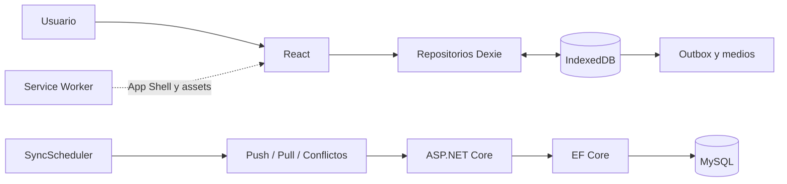

# FarmBovi

Plataforma ganadera **offline-first** concebida como una **Progressive Web App (PWA) instalable**. La documentación base describe React 19, TypeScript, Vite 8, Tailwind CSS 4, Dexie 4/IndexedDB, ASP.NET Core .NET 10, Entity Framework Core 10 y MySQL.

> **Alcance y precisión:** estos documentos se redactaron a partir del README adjunto y de la bitácora técnica compartida. No constituyen una auditoría independiente del repositorio en esta sesión. Las funciones descritas deben contrastarse con el código y las pruebas de la rama antes de considerarlas verificadas.

## Objetivo

Permitir registrar hato, trazabilidad, pesajes y actividades ganaderas en campo sin conexión y en oficina, conservando cambios localmente y sincronizándolos con el servidor cuando vuelva la conectividad.

## Tecnologías declaradas

| Área | Tecnología |
|---|---|
| Frontend | React 19, TypeScript, Vite 8, Tailwind CSS 4, React Router 7 |
| PWA | vite-plugin-pwa 2, Workbox 7, `injectManifest` |
| Persistencia local | Dexie 4 sobre IndexedDB |
| Backend | ASP.NET Core / .NET 10 |
| ORM | Entity Framework Core 10 |
| Base de datos | MySQL 8.0+ |

## Arquitectura



## Estructura conceptual

```text
FarmBovi/
├── FrontEnd/
│   ├── public/manifest.webmanifest
│   ├── src/pwa/
│   ├── src/lib/database/
│   ├── src/services/
│   ├── src/hooks/
│   ├── src/components/
│   ├── src/App.tsx
│   └── vite.config.ts
├── BackEnd/
│   ├── Controllers/
│   ├── Data/
│   ├── DTOs/
│   ├── Models/
│   └── Migrations/
├── BackEnd.Tests/
└── docs/
```

La estructura es orientativa y debe cotejarse con el árbol real de la rama.

## Requisitos y ejecución

Requisitos declarados: Node.js 24 LTS, npm, SDK .NET 10 y MySQL 8.0+.

Backend, desde la raíz:

```bash
dotnet restore FarmBovi.sln --locked-mode
dotnet tool restore
dotnet run --project BackEnd --launch-profile http
```

La fuente indica API en `http://localhost:5080` y Swagger en `http://localhost:5080/swagger`.

Frontend, desde otra terminal:

```bash
cd FrontEnd
npm ci
npm run dev
```

URL indicada: `http://localhost:5173/dashboard`.

Build y preview:

```bash
cd FrontEnd
npm run build
npm run preview
```

URL indicada: `http://localhost:4173`.

## Estado y limitaciones declaradas

Esta rama incluye Login JWT, endpoints de sincronización Push/Pull y persistencia de cambios en el backend. En el frontend, la cola local y los motores de sincronización requieren completar y validar la integración con el contrato real. BoviScale conserva su proxy de IA como pendiente.

Para el contrato de sincronización y el reparto de trabajo, consulta [08-contrato-sincronizacion.md](docs/08-contrato-sincronizacion.md) y [09-entrega-roberto.md](docs/09-entrega-roberto.md).

## Índice

- [01. Inicio y configuración](docs/01-inicio.md)
- [02. Arquitectura](docs/02-arquitectura.md)
- [03. Frontend](docs/03-frontend.md)
- [04. Backend](docs/04-backend.md)
- [05. Base de datos](docs/05-base-de-datos.md)
- [06. PWA](docs/06-pwa.md)
- [07. Offline-First](docs/07-offline-first.md)
- [08. Sincronización](docs/08-sincronizacion.md)
- [09. BoviScale](docs/09-boviscale.md)
- [10. Permisos y dispositivos](docs/10-permisos-y-dispositivos.md)
- [11. Seguridad](docs/11-seguridad.md)
- [12. Problemas y soluciones](docs/12-problemas-y-soluciones.md)
- [13. Validación y pruebas](docs/13-validacion-y-pruebas.md)
- [14. Historial de desarrollo](docs/14-historial-desarrollo.md)
- [15. Inventario de cambios](docs/15-inventario-cambios.md)
- [16. Decisiones técnicas](docs/16-decisiones-tecnicas.md)

```bash
npm run lint
npm run typecheck
npm run build
```

Desde la raíz:

```bash
dotnet restore FarmBovi.sln --locked-mode
dotnet build FarmBovi.sln --configuration Release --no-restore
```

`package-lock.json`, `packages.lock.json` y el manifiesto de herramientas fijan las dependencias. GitHub Actions ejecuta la compilación y las comprobaciones del frontend en cada push o pull request.

## Alcance actual

El backend incluye usuarios, login JWT, autorización global y por rancho en los controladores CRUD y endpoints de sincronización para varios ranchos. La interfaz incluye motores offline; revisa las guías de sincronización y validación para conocer los límites de la integración actual.

Repositorio público: [CJ-REYES/FarmBovi](https://github.com/CJ-REYES/FarmBovi).
