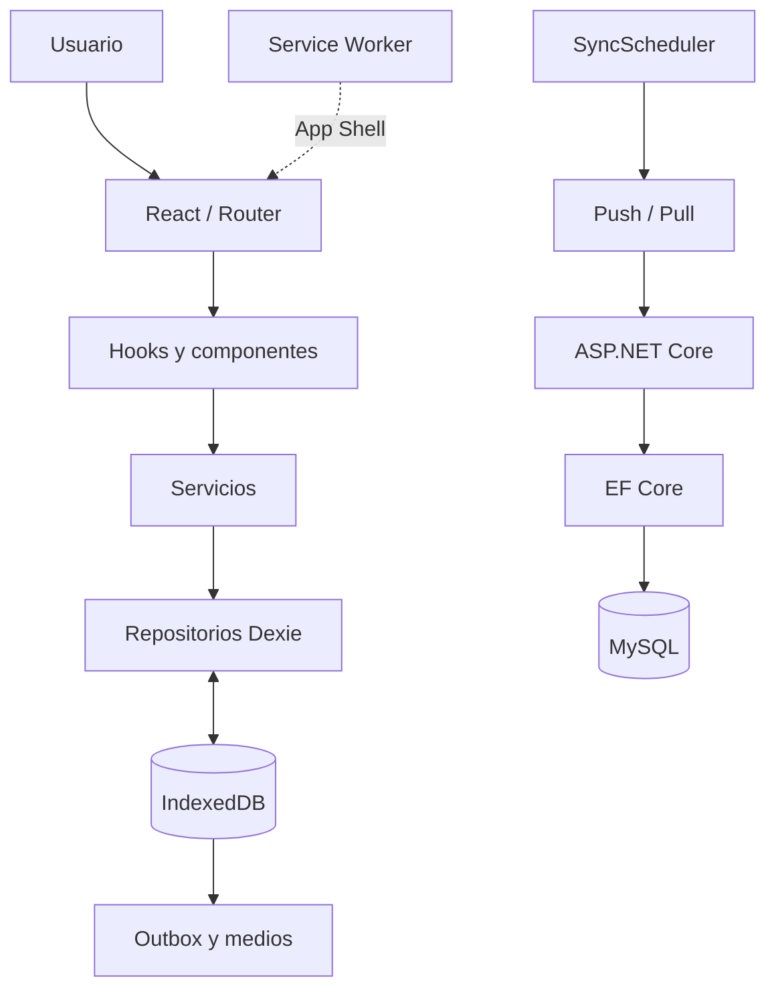

# 02. Arquitectura general

FarmBovi se describe como una plataforma offline-first: React presenta la interfaz; Dexie administra datos locales en IndexedDB; ASP.NET Core ofrece la API central y EF Core accede a MySQL.

## Frontend
- Presentación: páginas, componentes y layout.
- Hooks: conectividad, sincronización, permisos, almacenamiento y PWA.
- Servicios: coordinación de capacidades y tareas.
- Persistencia: Dexie/IndexedDB.
- Integración remota: cliente HTTP `/api/*`.

## Backend
La fuente identifica controladores REST, DTOs, modelos, `FarmDbContext`, migraciones EF Core y MySQL. La estructura concreta debe confirmarse en el código.

## Flujo offline
1. El usuario registra o modifica información.
2. La aplicación guarda localmente.
3. La operación pendiente se conserva en Outbox.
4. El scheduler detecta conectividad.
5. El cliente intenta Push y Pull.
6. Los conflictos se presentan para resolución.

La sincronización remota completa depende de endpoints servidor funcionales. IndexedDB no es una frontera de seguridad: el servidor debe validar identidad, autorización, rancho y versiones.
