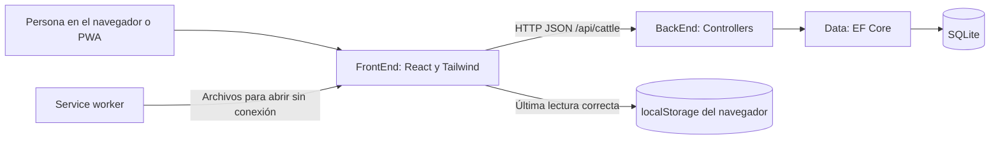

# Arquitectura

Hay dos aplicaciones independientes dentro de un mismo repositorio. React dibuja la interfaz y ASP.NET Core procesa los datos. SQLite pertenece al backend; el navegador nunca abre directamente esa base de datos.

## FrontEnd

| Archivo o carpeta | Responsabilidad |
| --- | --- |
| `src/main.tsx` | Monta React, estilos y fuentes locales |
| `src/App.tsx` | Pantalla del ganado, búsqueda y acciones |
| `src/components/CattleForm.tsx` | Formulario de alta y edición |
| `src/components/PwaStatus.tsx` | Instalación, disponibilidad sin conexión y actualización |
| `src/hooks/useCattle.ts` | Consulta la API, mantiene estados y recupera la copia local |
| `src/hooks/useInstallPrompt.ts` | Escucha los eventos de instalación del navegador |
| `src/lib/api.ts` | URL de la API, fetch, cancelación, timeout y errores |
| `src/lib/cattle-cache.ts` | Guarda y lee el listado con fecha y versión |
| `src/types/cattle.ts` | Contratos TypeScript del módulo |
| `src/index.css` | Tailwind v4, colores, fuentes y componentes visuales |
| `public/` | Iconos que Vite copia al build |
| `vite.config.ts` | Plugins, proxy local y generación PWA |

Tailwind v4 usa `@import 'tailwindcss'` y tokens `@theme` en CSS. No requiere un `tailwind.config.js` para esta configuración. Se integra mediante el plugin oficial [Tailwind para Vite](https://tailwindcss.com/docs/installation/using-vite).

Las fuentes se incluyen como dependencias `@fontsource` y se guardan en la precaché. No dependen de Google Fonts o de una conexión externa para dibujar la interfaz.

## BackEnd

| Archivo o carpeta | Responsabilidad |
| --- | --- |
| `Program.cs` | Registra dependencias y configura el pipeline HTTP |
| `Controllers/` | Recibe peticiones y devuelve respuestas HTTP |
| `DTOs/` | Define los datos de entrada y salida, con validación |
| `Models/` | Representa las entidades persistentes |
| `Data/FarmDbContext.cs` | Configura tablas y el índice único del arete |
| `Data/DatabaseHealthCheck.cs` | Comprueba la conexión a SQLite |
| `Migrations/` | Guarda cambios del esquema para reconstruir la base |
| `App_Data/` | Base SQLite local, generada e ignorada por Git |
| `Properties/launchSettings.json` | Puertos y entornos de los perfiles locales |

El `DbContext` se registra con duración *scoped*: cada petición recibe su instancia. Las consultas usan operaciones asíncronas y admiten cancelación. La lectura usa `AsNoTracking`, porque no va a modificar entidades cargadas.

El alcance inicial permite usar EF Core desde el controlador sin otra capa de repositorios. Cuando los módulos crezcan, mueve las reglas de negocio a servicios y conserva los controladores como entrada HTTP. No hace falta dividir cada carpeta en un proyecto separado para comenzar.

## Recorrido de un alta

1. El formulario recoge arete, nombre opcional, raza, sexo y fecha opcional.
2. `api.ts` envía JSON por `POST /api/cattle` con un timeout de 10 segundos.
3. ASP.NET Core valida `CattleRequest`. Si falla, responde `400` con detalles.
4. El controlador normaliza el arete a mayúsculas y guarda mediante EF Core.
5. SQLite impide duplicar un arete. El conflicto se transforma en `409`.
6. La API devuelve `201`, el registro y su URL en `Location`.
7. React actualiza el listado y vuelve a consultarlo. La lectura se guarda con fecha.

Los errores no capturados usan `ProblemDetails`, un contrato de error HTTP; los detalles internos se registran en el servidor. Una respuesta de error de validación o autorización no se disfraza como una lectura sin conexión.

## Desarrollo y producción

En desarrollo, el navegador solicita `/api` a Vite y Vite lo reenvía a `localhost:5080`. Ambos servidores tienen que estar encendidos. Las peticiones directas a otro origen usan CORS; están permitidos los puertos locales previstos.

En producción puedes servir el frontend junto con la API o en un servidor distinto. El proxy de Vite existe únicamente en desarrollo y preview. El backend no permite orígenes externos por defecto en producción; configúralos si separas los dominios.

La instalación PWA cambia cómo se abre React, pero no convierte la API en un programa instalado en el teléfono. La base principal sigue en el servidor.
