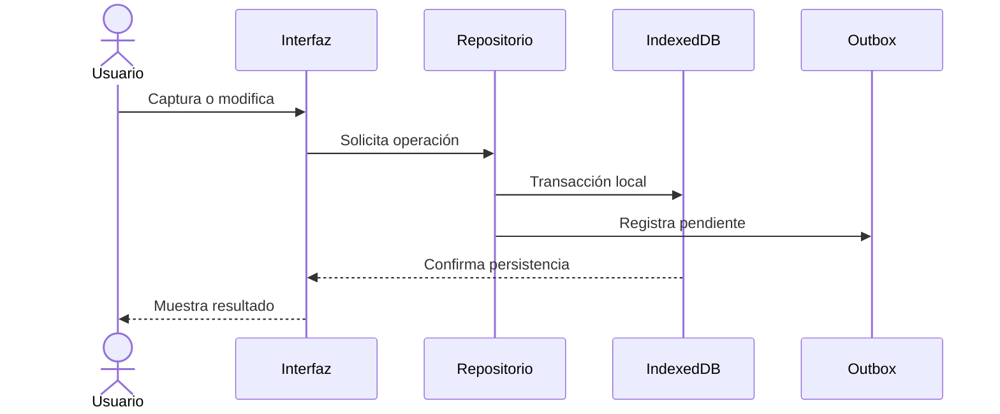

# 07. Estrategia Offline-First

El objetivo es permitir operaciones locales sin conexión continua. Dexie administra IndexedDB y la bitácora declara catorce repositorios transaccionales y una base `FarmBoviLocalDB`.

## Escritura local

La operación de dominio y su registro pendiente deben mantenerse coherentes. No indiques éxito si la persistencia falla.

## Almacenamiento
La bitácora menciona `StoragePersistenceService`, `useStorageHealth`, `navigator.storage.estimate()`, `persist()` y manejo de `QuotaExceededError`. La persistencia solicitada no garantiza espacio ilimitado.

## Medios y reglas
Las fotografías se describen como `Blob` en `db.media`, con trabajos diferidos. Conserva archivos hasta confirmar su procesamiento/carga. Usa identificadores estables, reintentos idempotentes, estados visibles y recuperación ante fallos. No borres operaciones pendientes antes de aceptación remota.
