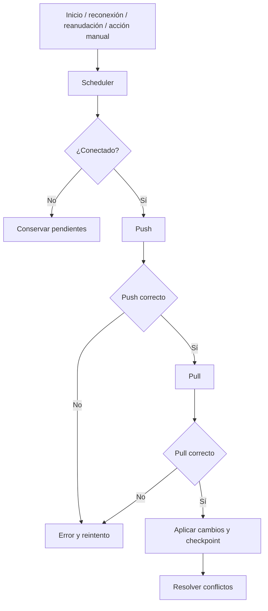

# 08. Sincronización

## Componentes mencionados
`SyncScheduler`, `PushSyncEngine`, `SyncPullEngine`, `ConflictResolver`, `outbox` y checkpoints/metadatos locales.

La bitácora menciona disparadores al iniciar, reconectar, reanudar, mutar datos, sondeo periódico y acción manual. El intervalo descrito es 45 segundos; confirma el valor en código.

Cada operación necesita ID estable e idempotencia. No elimines Outbox al iniciar la petición. El checkpoint Pull solo debe avanzar después de aplicar correctamente los cambios. Si el cursor es opaco, el cliente no debe interpretarlo.

## Conflictos
Una edición basada en versión antigua puede entrar en conflicto con otra edición remota. No descartes silenciosamente ninguna versión. La bitácora menciona `SyncConflictsPanel.tsx` y actualización de pendientes, checkpoints y conflictos al resolver.

## Estado declarado
El README identifica pendientes `POST /api/sync/push` y `GET /api/sync/pull`. Por ello, arquitectura cliente lista no equivale a sincronización remota completa.
